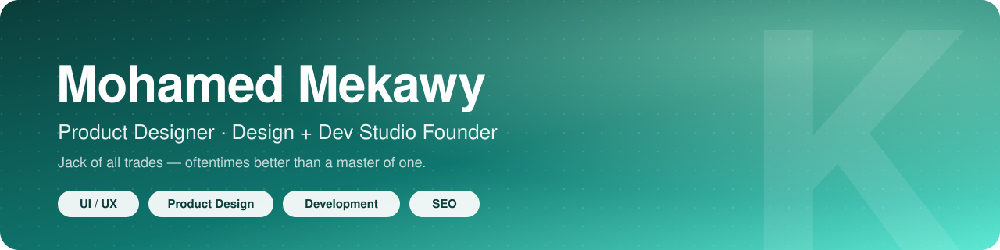

  

  
  
  

---

### 👋 Hey, I'm Mekawy

I design digital products end to end — from the first idea and UX flows, to polished UI in Figma, to shipping it live with my development team.
I run a small studio that takes products **from Figma to production**: websites, mobile apps, e-commerce stores and brand identities.

> *Jack of all trades, master of none — but oftentimes better than a master of one.*

### ✦ What I do

- 🎨 **Product & UI/UX Design** — web + mobile apps, design systems, prototypes
- 💻 **Development** — websites, web apps and stores, built and shipped
- 🧭 **Brand Identity** — logos, brand guides and visual systems
- 📈 **SEO & Growth** — search visibility, performance and analytics

### 🧰 Toolbox

  

